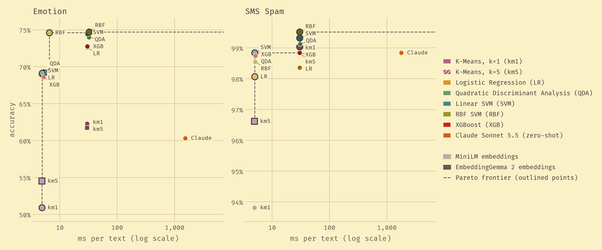

# LLSVM

Embed text with a small language model, then classify it with a classical model such as an SVM. On both of our benchmarks this matches or beats zero-shot popular LLMs, at 47–360× lower latency per text and with no per-call cost.

<picture>
  <source media="(prefers-color-scheme: dark)" srcset="results/plots/pareto-dark.png">
  
</picture>

Up and to the left is better.

- **Claude is never on the frontier.** On both datasets the frontier is made up only of embedding + classifier pipelines. On Emotion, 12 of the 14 trained models beat Claude's 60.3%; only the two k-means models on MiniLM fall below it. SMS Spam is practically solved, and there Claude sits mid-pack at 98.8%.
- **The embedder sets the speed, not the classifier.** Points form two columns: about 5 ms per text with MiniLM and 30 ms with EmbeddingGemma 2, against 1.5–1.8 s on average per Claude request at low effort.
- **The smaller encoder is often enough.** On Emotion, MiniLM with an RBF SVM scores 74.6% at 6.6 ms. That is effectively tied with the best model (EmbeddingGemma 2 with an RBF SVM, 74.7%, a difference of 4 texts out of 4,000) at about a fifth of its latency.

Every model's accuracy, side by side, is in the [full accuracy chart](results/plots/accuracy.png).

| | SMS Spam (2 classes) | Emotion (6 classes) |
|---|---|---|
| MiniLM + best classifier | 98.8% (linear SVM) · **5.0 ms** / text | 74.6% (RBF SVM) · **6.6 ms** / text |
| EmbeddingGemma 2 + best classifier | **99.5%** (RBF SVM) · 30.2 ms / text | **74.7%** (RBF SVM) · 32.5 ms / text |
| Claude Sonnet 5.5, zero-shot | 98.8% · 1,788 ms / text | 60.3% · 1,533 ms / text |
| Always guess the most common label | 87.3% | 35.0% |

How these were measured: see [Notes](#notes) at the bottom.

Through the API at list prices, the same zero-shot Claude Sonnet 5.5 call would cost at least about $200 per 1M texts (about $10 with Claude Haiku 5.5). The local pipeline has no per-call cost.

## Why this repo exists

**The idea.** Large language models (LLMs) have completely changed the world of software development, and my personal
field of machine learning. They are the most powerful tool yet, but that does not mean that they rule the roost for
every task. LLMs are slow, expensive, and often overkill for simple classification tasks, yet many teams in production
write wrappers around their core business logic to call an LLM. What if you could get more out of less? Is there more to
ML than just calling LLMs? These are the questions that led me to create this repo.

**What we found.** On SMS Spam, the MiniLM linear SVM ties Claude at 98.8% accuracy at about 360x less latency, and
EmbeddingGemma 2 with an RBF SVM edges past it at 99.5%. Emotion is the harder test, and there the classical pipeline
wins more readily: 74.6% for MiniLM against 60.3% for Claude, whose macro-F1 is 0.55. Even plain logistic regression on MiniLM embeddings (69.0%) beats it. The classifier adds at most 2.5 ms (the RBF SVM on Emotion), while taking about 30s to train on 16,000 texts.

**Limitations.** The LLM baseline is one model with a short zero-shot prompt and low effort. Few-shot examples or more effort might close the Emotion gap. Claude's latency includes the network round trip and Claude Code's overhead. We never tested on an edge device like a phone.

## Running it

    uv run experiment.py                     # SMS Spam, every embedder
    uv run experiment.py --dataset emotion
    uv run experiment_claude.py --dataset emotion   # Claude baseline (asks before sending requests)

Each `experiment.py` run goes through every embedder in `EMBEDDERS` and writes `results/<dataset>_<embedder>.csv` and `results/<dataset>_<embedder>.json` for each. `experiment_claude.py` writes to `results/claude/`. Then:

    uv run results/plot_summary.py   # results/plots/pareto.png (the chart above) and accuracy.png
    uv run results/plot.py           # per-run plots: results/plots/<dataset>_<embedder>.png

Per-run plots compare all seven classifiers, e.g. [SMS Spam with MiniLM](results/plots/sms_spam_minilm.png).

### macOS

XGBoost and PyTorch each ship an OpenMP runtime (`libomp`), and loading both in one
process segfaults. `.env-macos` points XGBoost at PyTorch's copy. From the repo root, either
pass it per command or set it once for your shell:

    uv run --env-file .env-macos experiment.py
    export UV_ENV_FILE=.env-macos

## Notes

- **Trained vs. zero-shot.** Every classifier is trained on its dataset's labeled train split. Claude Sonnet 5.5 gets only the label names, at low effort, one request per text.
- **Accuracy** is measured on the test split: 4,000 texts for Emotion and 1,035 for SMS Spam. The table's "best classifier" rows are the most accurate of seven, picked on the test split. The charts show all seven instead.
- **Local time** is embedding + classifier for one text at a time, the mean over 100 test texts on an Apple M2 Pro laptop. The embedder picks its own device. Training time is not included.
- **Claude time** is the mean model time per request reported by headless Claude Code (the same statistic as local time). It leaves out about 1.1 s per request of CLI startup and overhead, but includes the network round trip and Claude Code's own prompt.
- **Pareto chart.** Latencies within 10% of each other count as tied, so a model is on the frontier only if nothing at least as accurate is within 10% of its speed. Some frontier points still differ by only a few test texts, so treat the exact frontier membership as noisy.

## Author
Hi! I'm Gersi Doko, a PhD student at the University of New Hampshire studying reinforcement learning. After my internship at
Amazon NYC where I optimized LLM inference I wanted to explore how LLMs compare to classical ML models. Then this repo
was born! Feel free to dig around, and if you have any questions or suggestions, please reach out to me at the email
located in my resume hosted at [gersid.github.io/resume.pdf](https://gersid.github.io/assets/pdf/resume.pdf).
