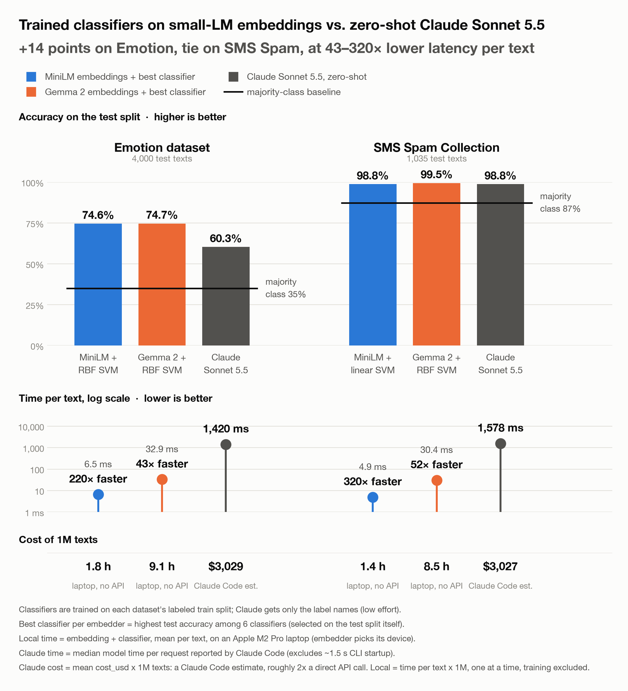

# LLSVM

Embed text with a small language model, then classify it with an SVM: as accurate as zero-shot Claude Sonnet 5.5, or more, at 43–320× lower latency per text and no per-call cost.

<picture>
  <source media="(prefers-color-scheme: dark)" srcset="results/plots/summary-dark.png">
  
</picture>

| | SMS Spam (2 classes) | Emotion (6 classes) |
|---|---|---|
| MiniLM + best classifier | 98.8% · **4.9 ms** / text | 74.6% · **6.5 ms** / text |
| Gemma 2 + best classifier | **99.5%** · 30.4 ms / text | **74.7%** · 32.9 ms / text |
| Claude Sonnet 5.5, zero-shot | 98.8% · 1,578 ms / text · ~$3,000 / 1M texts | 60.3% · 1,420 ms / text · ~$3,000 / 1M texts |
| Always guess the most common label | 87.3% | 35.0% |

Accuracy on the test split. Local times are embedding + classifier, one text at a time, mean over 100 test texts on an Apple M2 Pro laptop. Claude times are the median model time per request reported by Claude Code, and its cost is Claude Code's estimate. "Best classifier" is the most accurate of six, picked on the test split.

## Why this repo exists

**The idea.** Large language models (LLMs) have changed what we can do with text. Yet most classifiers running in production are still support vector machines (SVMs), logistic regressions and gradient-boosted trees. They are cheap to run, their failure modes are well understood, and decades of research cover how they generalize and how to calibrate them. LLSVM (LLMs + SVMs) keeps those models and changes only their input. A small pretrained language model turns each text into an embedding, and a classical classifier makes the decision from that vector.

**Why it should be fast.** The language model only reads the text and never generates any, so a compact encoder like MiniLM is enough. The classifier on top predicts with a dot product or a small tree ensemble. That suits fast inference, on-device computing, and anywhere else a full LLM call is too slow, too expensive or too far from the data.

**What we test.** Each experiment embeds a dataset once and trains several classifiers on the same embeddings: a majority-class baseline, nearest-centroid (k-means), logistic regression, linear and RBF SVMs, and XGBoost. Each one is scored on accuracy, macro-F1 (F1 averaged equally over classes, so rare classes count), training time and per-text latency. As the LLM baseline, Claude Sonnet 5.5 labels every test text zero-shot, one request per text.

**What we found.** On SMS Spam, the MiniLM pipeline ties Claude at 98.8% accuracy, and Gemma 2 with an RBF SVM edges past it at 99.5%. That dataset is close to solved, though (guessing "not spam" every time already scores 87%), so gaps this small are probably noise. Emotion is the harder test, and there the classical pipeline wins clearly: 74.6% for MiniLM against 60.3% for Claude, whose macro-F1 is 0.55. Even plain logistic regression on MiniLM embeddings (69.0%) beats it. Almost all of the local inference time goes to the encoder, at about 5 ms per text for MiniLM and 30 ms for Gemma 2. The classifier adds 0.01–0.3 ms, apart from the RBF SVM (up to 2.6 ms on Emotion).

**Limitations.** The classifiers learn from each dataset's labeled training split, while Claude sees only the label names, so this compares a trained pipeline with an untrained one. The LLM baseline is one model with a short zero-shot prompt and low effort. Few-shot examples or more effort might close the Emotion gap. Claude's latency includes the network round trip, and its cost is Claude Code's estimate rather than an API bill. Other gaps: two embedders, one train/test split with no confidence intervals, the best classifier picked on the test split, default hyperparameters, and no measurements on a phone or other edge device.

## Running it

    uv run experiment.py                     # SMS Spam, every embedder
    uv run experiment.py --dataset emotion
    uv run experiment-claude.py --dataset emotion   # Claude baseline (asks before sending requests)

Each `experiment.py` run goes through every embedder in `EMBEDDERS` and writes `results/<dataset>_<embedder>.csv` and `results/<dataset>_<embedder>.json` for each. `experiment-claude.py` writes to `results/claude/`. Then:

    uv run results/plot_summary.py   # headline figure: results/plots/summary.png
    uv run results/plot.py           # per-run plots: results/plots/<dataset>_<embedder>.png

Per-run plots compare all six classifiers, e.g. [SMS Spam with MiniLM](results/plots/sms_spam_minilm.png).

### macOS

XGBoost and PyTorch each ship an OpenMP runtime (`libomp`), and loading both in one
process segfaults. `.env-macos` points XGBoost at PyTorch's copy. From the repo root, either
pass it per command or set it once for your shell:

    uv run --env-file .env-macos experiment.py
    export UV_ENV_FILE=.env-macos
