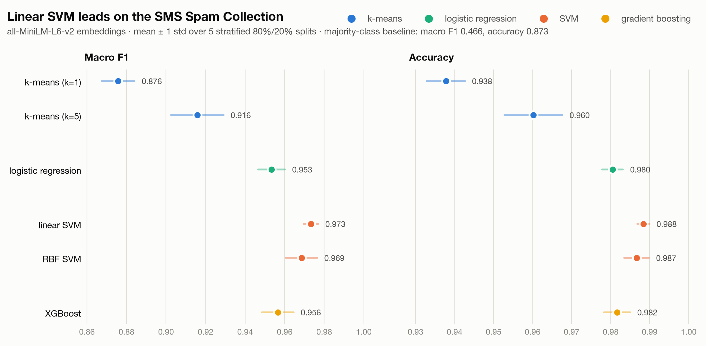

# LLSVM
Classification via LLM encoding then SVM inference for inference speed, and machine processing, for multiple domains.

## macOS

XGBoost and PyTorch each ship an OpenMP runtime (`libomp`), and loading both in one
process segfaults. `.env-macos` points XGBoost at PyTorch's copy. From the repo root, either
pass it per command or set it once for your shell:

    uv run --env-file .env-macos experiment.py
    export UV_ENV_FILE=.env-macos

## TODO

- [ ] Professionalism pass over the whole project: comments, docstrings, naming and consistency.
- [ ] Write the story behind this repo, below the plot.
