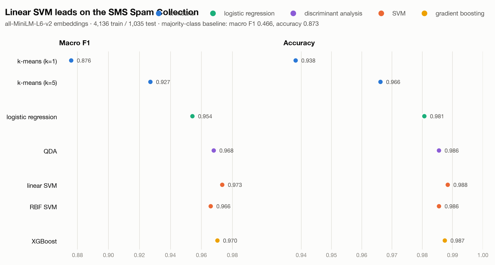

# LLSVM

Embed text once with a small language model, then classify it with an SVM: about 5 ms per text on a laptop, with no LLM calls.

| | SMS Spam (2 classes) | Emotion (6 classes) |
|---|---|---|
| MiniLM embedding | 4.7 ms / text | 4.8 ms / text |
| Linear SVM on top | **+0.06 ms**, 98.8% accuracy | +0.06 ms, 69.1% accuracy |
| Best classifier | linear SVM, 0.97 macro-F1 | RBF SVM, 0.67 macro-F1 (+1.7 ms) |
| Always guess the most common label | 87.3% accuracy | 35.0% accuracy |

Apple M2 Pro laptop, one text at a time, mean over 100 test texts. Classifier times are on top of the embedding time.

## Why this repo exists

**The idea.** Large language models (LLMs) have changed what we can do with text. Yet most classifiers running in production are still support vector machines (SVMs), logistic regressions and gradient-boosted trees. They are cheap to run, their failure modes are well understood, and decades of research cover how they generalize and how to calibrate them. LLSVM (LLMs + SVMs) keeps those models and changes only their input. A small pretrained language model turns each text into an embedding, and a classical classifier makes the decision from that vector.

**Why it should be fast.** The language model only reads the text and never generates any, so a compact encoder like MiniLM is enough. The classifier on top predicts with a dot product or a small tree ensemble. That suits fast inference, on-device computing, and anywhere else a full LLM call is too slow, too expensive or too far from the data.

**What we test.** Each experiment embeds a dataset once and trains several classifiers on the same embeddings: a majority-class baseline, nearest-centroid (k-means), logistic regression, linear and RBF SVMs, and XGBoost. Each one is scored on accuracy, macro-F1 (F1 averaged equally over classes, so rare classes count), training time and per-text latency.

**What we found.** Almost all of the inference time goes to the encoder, at about 5 ms per text. The classifier adds 0.01–0.3 ms, apart from the RBF SVM on Emotion. On SMS Spam, a linear SVM reaches 0.97 macro-F1 with 54 ms of training on precomputed embeddings. That dataset is close to solved, though (guessing "not spam" every time already scores 87%), so the small gaps between the top classifiers are probably noise. Emotion is the harder test: the best classifier reaches 0.67 macro-F1, well below what fine-tuned transformers report on this dataset.

**Limitations.** There is no LLM baseline yet, so the speedup over prompting an LLM is not measured (see [TODO.md](TODO.md)). Other gaps: one embedder (MiniLM), one train/test split with no confidence intervals, default hyperparameters, and no measurements on a phone or other edge device.

## Running it

    uv run experiment.py                     # SMS Spam, every embedder
    uv run experiment.py --dataset emotion

Each run goes through every embedder in `EMBEDDERS` and writes `results/<dataset>_<embedder>.csv` and `results/<dataset>_<embedder>.json` for each. Then `uv run results/plot.py` makes `results/plots/<dataset>_<embedder>.png`.

### macOS

XGBoost and PyTorch each ship an OpenMP runtime (`libomp`), and loading both in one
process segfaults. `.env-macos` points XGBoost at PyTorch's copy. From the repo root, either
pass it per command or set it once for your shell:

    uv run --env-file .env-macos experiment.py
    export UV_ENV_FILE=.env-macos
