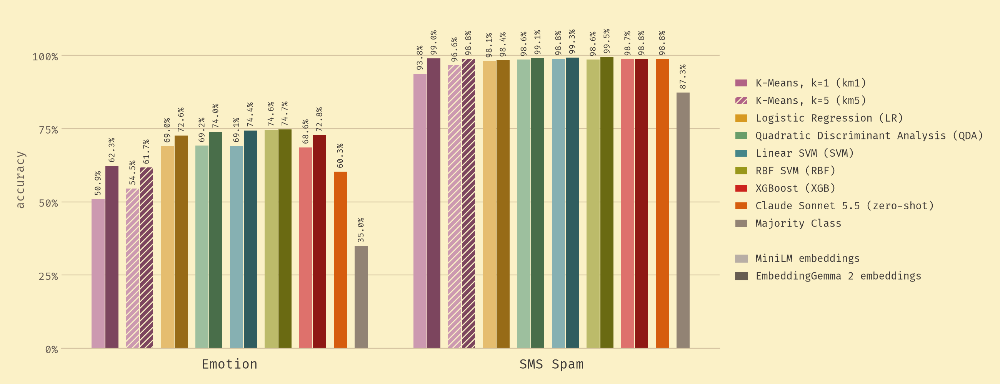
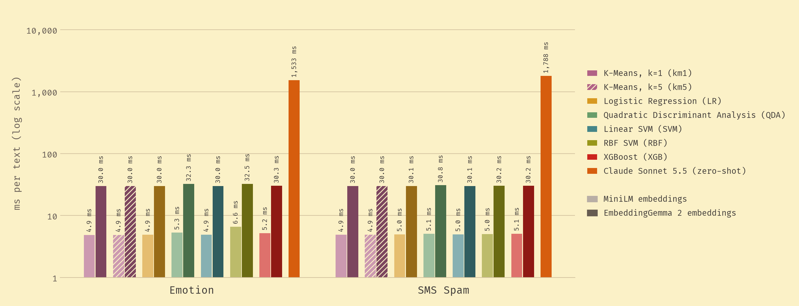

# LLSVM

Embed text with a small language model, then classify it with a classical model such as an SVM. On both of our benchmarks this matches or beats zero-shot Claude Sonnet 5.5, at 47–360× lower latency per text and with no per-call cost.

<!-- TODO: add a three-bullet takeaway or a short "when to use this vs. an LLM API" guide here, above the figures.
     e.g. stable labels + high volume + latency or privacy limits -> embeddings + classical classifier;
     no labeled data, categories that change often, or low volume -> prompt an LLM. -->

We embed each text with one of two small encoders, MiniLM or EmbeddingGemma 2, and train seven classical classifiers on the embeddings. We compare them with Claude Sonnet 5.5 labeling the same test texts zero-shot, on two datasets: Emotion (tweets, 6 classes) and SMS Spam (2 classes). The classifiers learn from each dataset's labeled training split (16,000 and 4,136 texts), while Claude gets only the label names, so this is a trained pipeline against an untrained one.

**Accuracy.** On Emotion, 12 of the 14 trained models beat Claude (60.3%). Only the two k-means models on MiniLM fall below it. SMS Spam is close to solved: guessing "not spam" every time already scores 87%. There, every model lands between 94% and 99.5%, and Claude sits mid-pack at 98.8%.

<picture>
  <source media="(prefers-color-scheme: dark)" srcset="results/plots/accuracy-dark.png">
  
</picture>

**Speed.** The embedder sets the speed, not the classifier: about 5 ms per text with MiniLM and 30 ms with EmbeddingGemma 2, against 1.5–1.8 s on average per Claude request.

<picture>
  <source media="(prefers-color-scheme: dark)" srcset="results/plots/speed-dark.png">
  
</picture>

**The trade-off.** The dashed line is the Pareto frontier: the methods for which no other method is at least as fast and at least as accurate. On both datasets it is made up only of embedding + classifier pipelines, and Claude is slower and no more accurate than the best of them. Within the frontier, the smaller encoder is often enough. On Emotion, MiniLM with an RBF SVM scores 74.6% at 6.6 ms, effectively tied with the best model (EmbeddingGemma 2 with an RBF SVM, 74.7%, a difference of 4 texts out of 4,000) at about a fifth of its latency.

<picture>
  <source media="(prefers-color-scheme: dark)" srcset="results/plots/pareto-dark.png">
  
</picture>

| | SMS Spam (2 classes) | Emotion (6 classes) |
|---|---|---|
| MiniLM + best classifier | 98.8% (linear SVM) · **5.0 ms** / text | 74.6% (RBF SVM) · **6.6 ms** / text |
| EmbeddingGemma 2 + best classifier | **99.5%** (RBF SVM) · 30.2 ms / text | **74.7%** (RBF SVM) · 32.5 ms / text |
| Claude Sonnet 5.5, zero-shot | 98.8% · 1,788 ms / text | 60.3% · 1,533 ms / text |
| Always guess the most common label | 87.3% | 35.0% |

How these were measured: see [Notes](#notes) at the bottom.

<!-- TODO: mention batch throughput. Embedding the whole test set in one batch takes about 0.3-0.4 ms per text
     (predict_seconds / n_test on the "embedding" row of results/*_minilm.csv), about 10x faster than one text at a time. -->
<!-- TODO: add a 5-line predict example (load embedder + trained classifier, classify one text, print label and ms),
     or a small demo, so a visitor can try it. -->

Through the API at list prices, the same zero-shot Claude Sonnet 5.5 call would cost at least about $200 per 1M texts (about $10 with Claude Haiku 5.5). The local pipeline has no per-call cost.

<!-- Estimate: input tokens >= (system prompt + mean text length) / 4 characters per token (about 75-80 tokens), output >= 5
     tokens (the JSON label), at $2 / $10 per 1M tokens for Sonnet 5.5 and $0.10 / $0.50 for Haiku 5.5. It leaves out the
     structured-output schema and any thinking tokens, so it is a floor. Claude Code's own estimate (~$3,000 per 1M texts)
     is about 10x higher because Claude Code adds ~1,100 tokens of its own prompt to every request. -->
<!-- TODO: measure instead of estimate: run `uv run --env-file .env-secrets experiment_claude.py --backend api --limit 200`
     on each dataset (real money, a few cents) to get API cost and latency. Claude Code's prompt also adds latency,
     so a direct API call may be faster than the 1.5-1.8 s measured here, which would shrink the speedup. -->
<!-- TODO: add a few-shot and/or Claude Haiku 5.5 row, so the LLM baseline isn't only zero-shot Sonnet at low effort. -->

## Why this repo exists

**The idea.** Large language models (LLMs) have changed what we can do with text. Yet most classifiers running in production are still support vector machines (SVMs), logistic regressions and gradient-boosted trees. They are cheap to run, their failure modes are well understood, and decades of research cover how they generalize and how to calibrate them. LLSVM (LLMs + SVMs) keeps those models and changes only their input. A small pretrained language model turns each text into an embedding, and a classical classifier makes the decision from that vector.

**Why it should be fast.** The language model only reads the text and never generates any, so a compact encoder like MiniLM is enough. The classifier on top predicts with a dot product or a small tree ensemble. That suits fast inference, on-device computing, and anywhere else a full LLM call is too slow, too expensive or too far from the data.

**What we test.** Each experiment embeds a dataset once and trains several classifiers on the same embeddings: a majority-class baseline, nearest-centroid (k-means with k=1 and k=5), logistic regression, quadratic discriminant analysis (QDA), linear and RBF SVMs, and XGBoost. Each one is scored on accuracy, macro-F1 (F1 averaged equally over classes, so rare classes count), training time and per-text latency. As the LLM baseline, Claude Sonnet 5.5 labels every test text zero-shot, one request per text.

**What we found.** On SMS Spam, the MiniLM linear SVM ties Claude at 98.8% accuracy, and EmbeddingGemma 2 with an RBF SVM edges past it at 99.5%. That dataset is close to solved, though (guessing "not spam" every time already scores 87%), so gaps this small are probably noise. Emotion is the harder test, and there the classical pipeline wins clearly: 74.6% for MiniLM against 60.3% for Claude, whose macro-F1 is 0.55. Even plain logistic regression on MiniLM embeddings (69.0%) beats it. QDA, the newest classifier, lands among the SVMs (74.0% on Emotion and 99.1% on SMS Spam with EmbeddingGemma 2). EmbeddingGemma 2 is more accurate than MiniLM with every classifier, at about six times the latency. Almost all of the local inference time goes to the encoder. The classifier adds at most 2.5 ms (the RBF SVM on Emotion), and usually well under 1 ms.

<!-- TODO: check whether the Emotion labels come from hashtags (distant supervision in Saravia et al., EMNLP 2018).
     If so, say that zero-shot Claude is partly penalized for the labeling convention, not only for understanding less. -->

**Limitations.** The classifiers learn from each dataset's labeled training split, while Claude sees only the label names, so this compares a trained pipeline with an untrained one. The LLM baseline is one model with a short zero-shot prompt and low effort. Few-shot examples or more effort might close the Emotion gap. Claude's latency includes the network round trip and Claude Code's overhead. Other gaps: two embedders, one train/test split with no confidence intervals, the best classifier picked on the test split, default hyperparameters, and no measurements on a phone or other edge device.

<!-- TODO: learning curve. Train each classifier on 10, 25, 50, 100, 250, 500, 1k, ... labeled examples per dataset and
     plot accuracy against training-set size, with zero-shot Claude as a horizontal line. The point where the curve
     crosses Claude is "how many labels you need to beat an LLM", which answers the trained vs. zero-shot objection
     head on. Runs locally, no API cost. -->
<!-- TODO: once TODO.md's model-selection item is done, replace "picked on the test split" and "no confidence intervals"
     above with the new protocol. -->

## Running it

    uv run experiment.py                     # SMS Spam, every embedder
    uv run experiment.py --dataset emotion
    uv run experiment_claude.py --dataset emotion   # Claude baseline (asks before sending requests)

Each `experiment.py` run goes through every embedder in `EMBEDDERS` and writes `results/<dataset>_<embedder>.csv` and `results/<dataset>_<embedder>.json` for each. `experiment_claude.py` writes to `results/claude/`. Then:

    uv run results/plot_summary.py   # headline figures: results/plots/accuracy.png, speed.png, pareto.png
    uv run results/plot.py           # per-run plots: results/plots/<dataset>_<embedder>.png

Per-run plots compare all seven classifiers, e.g. [SMS Spam with MiniLM](results/plots/sms_spam_minilm.png).

### macOS

XGBoost and PyTorch each ship an OpenMP runtime (`libomp`), and loading both in one
process segfaults. `.env-macos` points XGBoost at PyTorch's copy. From the repo root, either
pass it per command or set it once for your shell:

    uv run --env-file .env-macos experiment.py
    export UV_ENV_FILE=.env-macos

## Notes

- **Trained vs. zero-shot.** Every classifier is trained on its dataset's labeled train split. Claude Sonnet 5.5 gets only the label names, at low effort, one request per text.
- **Accuracy** is measured on the test split: 4,000 texts for Emotion and 1,035 for SMS Spam. The table's "best classifier" rows are the most accurate of seven, picked on the test split. The figures show all seven instead.
- **Local time** is embedding + classifier for one text at a time, the mean over 100 test texts on an Apple M2 Pro laptop. The embedder picks its own device. Training time is not included.
- **Claude time** is the mean model time per request reported by headless Claude Code (the same statistic as local time). It leaves out about 1.1 s per request of CLI startup and overhead, but includes the network round trip and Claude Code's own prompt.
- **Pareto chart.** The majority class is left out: it has no model to time. Several frontier points differ by fractions of a millisecond or a few test texts, so treat the exact frontier membership as noisy.

<!-- TODO: author section: your name, links (site, LinkedIn, Google Scholar), one line on how this connects to your
     research, and a "what I'd extend next" line (e.g. on-device benchmark, more datasets, fine-tuned small transformer). -->
